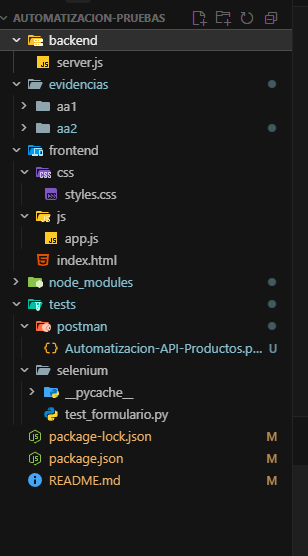
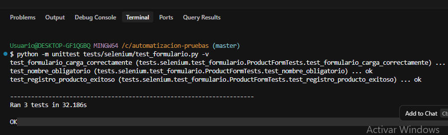
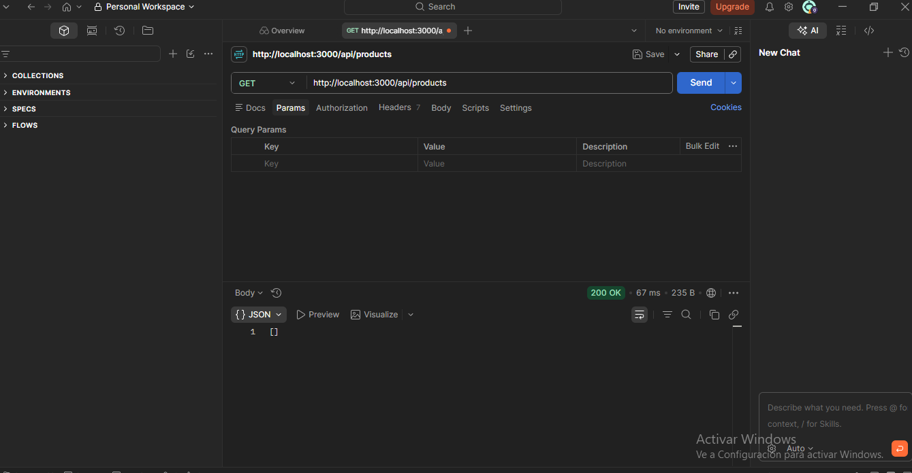
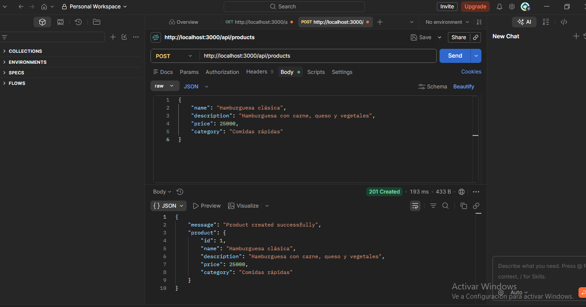
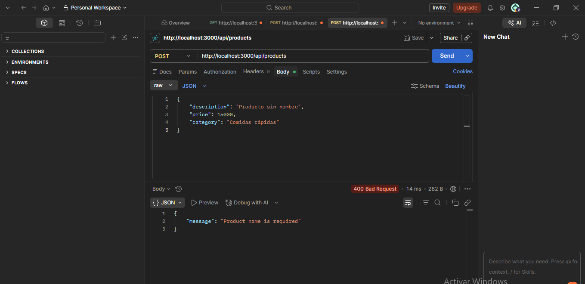
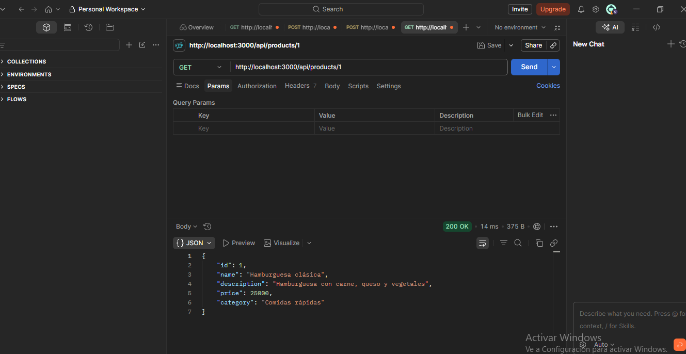
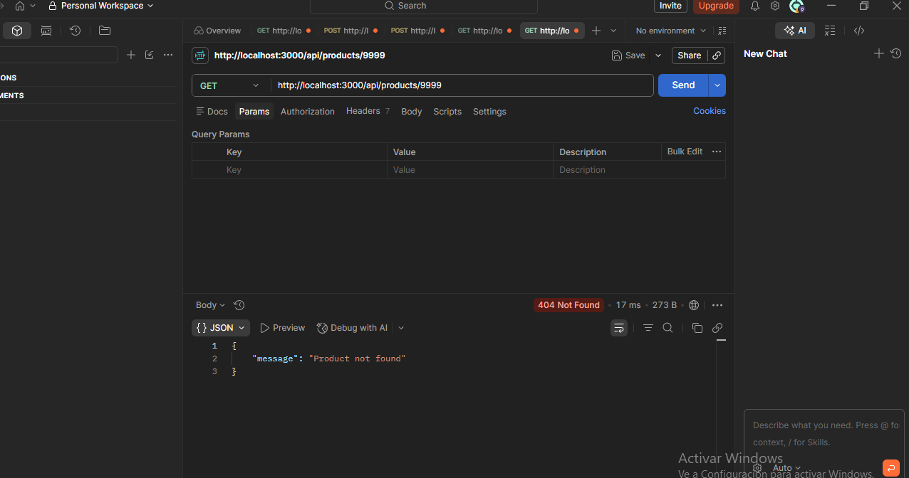
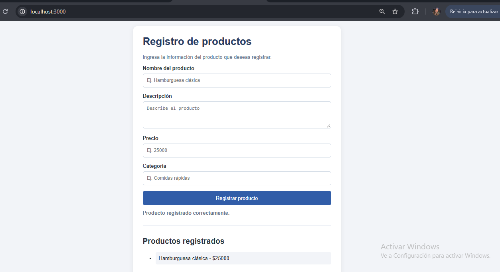

# 🧪 Manual de pruebas automatizadas
### AA1 – Diseño de scripts de prueba automatizados para servicios REST y formularios web

<p align="center">
  
  
  
  
  
</p>

## 1. Introducción

El presente proyecto tiene como finalidad diseñar y ejecutar scripts de pruebas automatizadas para un formulario web y un servicio REST. Para ello, se desarrolló una aplicación de registro de productos que permite comprobar el funcionamiento de sus principales operaciones y validar diferentes escenarios.

Se utilizaron Selenium para automatizar las pruebas del formulario web y Postman para diseñar y ejecutar pruebas de la API REST. Adicionalmente, se empleó Newman para ejecutar la colección de Postman desde la terminal.

## 2. Objetivos

**Objetivo general**

Diseñar y ejecutar pruebas automatizadas para verificar el funcionamiento de un formulario web y una API REST.

**Objetivos específicos**

- Implementar un formulario web para registrar productos.
- Desarrollar una API REST para crear y consultar productos.
- Diseñar pruebas automatizadas para validar el formulario mediante Selenium.
- Crear una colección de pruebas para la API utilizando Postman.
- Ejecutar las pruebas de la API mediante Newman.
- Documentar el proceso y los resultados obtenidos.

## 3. Tecnologías y herramientas

| Herramienta | Aplicación |
|---|---|
| Node.js 24 | Entorno de ejecución |
| Express.js | Desarrollo de la API REST |
| HTML, CSS y JavaScript | Formulario web |
| Python 3 | Ejecución de pruebas |
| Selenium | Automatización del formulario |
| Postman | Pruebas de servicios REST |
| Newman | Ejecución automatizada desde terminal |
| Git y GitHub | Control de versiones |

## 4. Estructura del proyecto

```text
automatizacion-pruebas/
│
├── backend/
│   └── server.js
│
├── frontend/
│   ├── index.html
│   ├── css/
│   │   └── styles.css
│   └── js/
│       └── app.js
│
├── tests/
│   ├── selenium/
│   │   └── test_formulario.py
│   │
│   └── postman/
│       └── Automatizacion-API-Productos.postman_collection.json
│
├── evidencias/
│   ├── aa1/
│   └── aa2/
│
├── documentacion/
├── package.json
├── package-lock.json
└── README.md
```

### Evidencia de la estructura



## 5. Descripción de la aplicación

Se desarrolló una aplicación para el registro y consulta de productos, compuesta por un formulario web y una API REST.

**Formulario web**

Permite ingresar el nombre, descripción, precio y categoría de un producto. Incluye validaciones para evitar registros sin nombre o con precios iguales o inferiores a cero. Cuando el registro es exitoso, muestra un mensaje de confirmación y actualiza la lista de productos.

**API REST**

Desarrollada con Express.js, permite registrar productos y consultar la información mediante solicitudes HTTP.

Los datos se almacenan temporalmente en memoria durante la ejecución del servidor; por lo tanto, se reinician cuando este se detiene.

## 6. Servicios REST implementados

Dirección base:

`http://localhost:3000/api/products`

| Método | Endpoint | Funcionalidad | Respuesta |
|---|---|---|---|
| GET | `/api/products` | Consultar todos los productos | 200 |
| POST | `/api/products` | Registrar un producto | 201 |
| GET | `/api/products/:id` | Consultar producto por ID | 200 |
| POST | `/api/products` | Validar registro sin nombre | 400 |
| GET | `/api/products/9999` | Consultar producto inexistente | 404 |

**Ejemplo de solicitud para registrar un producto:**

```json
{
  "name": "Hamburguesa especial",
  "description": "Hamburguesa con doble carne y queso",
  "price": 35000,
  "category": "Comidas rápidas"
}
```

## 7. Flujo de trabajo y ejecución

### 7.1. Instalación de dependencias

Se requiere tener instalado Node.js, Python y Google Chrome.

Desde la terminal, ubicarse en la carpeta del proyecto y ejecutar:

```bash
npm install
```

Instalar Selenium:

```bash
python -m pip install selenium
```

### 7.2. Iniciar el servidor

Ejecutar el siguiente comando:

```bash
npm start
```

El servidor estará disponible en:

`http://localhost:3000`

### 7.3. Verificar el formulario web

Abrir en el navegador la dirección del servidor. Desde el formulario se puede registrar un producto y comprobar que aparezca en la lista.

### 7.4. Ejecutar las pruebas con Selenium

Con el servidor activo, abrir una segunda terminal y ejecutar:

```bash
python -m unittest tests/selenium/test_formulario.py -v
```

Se implementaron tres casos de prueba:

| Caso | Validación |
|---|---|
| 1 | Verificar que el formulario cargue correctamente. |
| 2 | Comprobar que el nombre sea obligatorio. |
| 3 | Registrar un producto y verificar que aparezca en la lista. |

**Evidencia de ejecución de Selenium:**



**Resultado:** 3 pruebas ejecutadas correctamente.

### 7.5. Ejecutar las pruebas con Postman

Se creó la colección `Automatizacion API - Productos`, que contiene cinco solicitudes:

1. Consultar todos los productos.
2. Registrar un producto.
3. Validar el registro sin nombre.
4. Consultar un producto por ID.
5. Consultar un producto inexistente.

Cada solicitud incluye scripts de prueba para verificar los códigos de respuesta HTTP, los mensajes y los datos devueltos por la API.

**Evidencias de ejecución:**

**Consulta de productos**



**Registro de producto**



**Validación de nombre obligatorio**



**Consulta por ID**



**Consulta de producto inexistente**



**Formulario web de registro**



### 7.6. Ejecución de la colección con Newman

Newman permite ejecutar desde la terminal la colección creada en Postman.

Comando:

```bash
npx newman run tests/postman/Automatizacion-API-Productos.postman_collection.json
```

El servidor debe permanecer activo durante la ejecución.

## 8. Resultados de las pruebas

La ejecución de la colección mediante Newman presentó los siguientes resultados:

| Indicador | Resultado |
|---|---:|
| Solicitudes ejecutadas | 5 |
| Scripts de prueba | 5 |
| Aserciones realizadas | 11 |
| Aserciones fallidas | 0 |
| Estado | Aprobado |

Todas las solicitudes y aserciones finalizaron correctamente.

## 9. Reflexión sobre la utilidad de las pruebas automatizadas

Las pruebas automatizadas permiten verificar el funcionamiento de una aplicación de manera repetible y reducir las validaciones manuales. Durante el desarrollo se comprobó que Selenium facilita la interacción automática con los elementos de un formulario web, mientras que Postman permite validar los servicios REST y sus respuestas.

Por su parte, Newman facilita la ejecución de colecciones desde la terminal, permitiendo repetir las pruebas y detectar posibles errores después de realizar cambios en el código.

## 10. Conclusiones

Se implementó una aplicación de registro de productos y se diseñaron pruebas automatizadas para validar el formulario web y los servicios REST.

Las pruebas con Selenium finalizaron con tres casos aprobados. Por su parte, la colección ejecutada con Newman completó cinco solicitudes y once aserciones sin fallos.

El desarrollo permitió aplicar herramientas de automatización y comprender su importancia para verificar la funcionalidad y calidad de una aplicación de software.

## 11. Repositorio del proyecto

El código fuente, los scripts automatizados, la colección de Postman y las evidencias se encuentran disponibles en GitHub:

**[Ver repositorio – Automatización de pruebas](https://github.com/VivianaE10/automatizacion-pruebas)**

---

<p align="center">
  **AA1 – Diseño de scripts de prueba automatizados**
</p>

